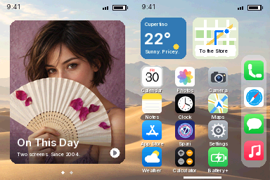

# iBroke Pro Max

**Two screens. One mortgage.**

My DS already had two screens and a hinge. Apparently, all it was missing was an iPhone interface and an unreasonable pricing strategy.

A playable, fully English Nintendo DS/DSi homebrew parody with a sideways foldable-phone interface, 16 mini-apps, widgets, a translucent dock, and an exceptionally ambitious fake App Store.



## Download

[**Download the latest ROM and release package**](https://github.com/0x1a4-dev/iBroke-Pro-Max/releases/latest)

Release **v2.1.0** is the English Fold Edition. The ROM file is named `iPhone_Dou.nds` and its launcher title is **iPhone Dou**. All required graphics and audio are embedded in that one file.

- Turn the DS **90° counterclockwise**: display on the left, touchscreen on the right.
- Swipe up or press **A** to unlock. **B** returns home; **START** locks.
- Use an existing homebrew loader, such as TWiLight Menu++.
- Emulator-tested in DeSmuME Libretro / Interpreter mode. **Physical DS/DSi testing is still pending.**

## Features

- iPhone-style home screen, photo/weather/map widgets, translucent dock, and two appearance options.
- Rotated touch input, correctly remapped D-pad, and home/unlock swipe gestures.
- Spari, Camera, App Store, Battery+, Messages, Weather, Calculator, Settings, Photos, Calendar, Notes, Maps, Phone, Safari, Music, and Clock.
- A working QWERTY note editor, integer calculator, stopwatch, original chiptunes, and a 30-second charger-catching minigame.
- An entirely fictional economy. Purchases use play money; phone calls, maps, camera captures, and Safari pages are offline simulations.
- No network requests or persistent save files. Session data stays in RAM.

Created by **0x1a4-dev** with assistance from **Codex**. Photo assets were generated with Imagegen; native app icons and controls are code-drawn. See [asset provenance](artwork/ASSETS.md) and [third-party notices](THIRD_PARTY.md).

## How to hold the DS

**Turn the open DS 90° to the left, counterclockwise.**

- The normally upper screen is now on the **left**. It displays photos, answers, conversations, route details, and other content.
- The touchscreen is now on the **right**. It contains the interactive interface.
- The ROM itself rotates the graphics. Touch coordinates and all four D-pad directions are remapped to match.
- The combined view is **384 × 256 pixels**, formed by two **192 × 256** panels placed side by side. The physical hinge gap remains.

Images in `preview/` show this sideways view. `00_native_rotation.png` also shows the raw emulator output with the DS screens stacked normally; its contents are intentionally sideways.

## Run on a DSi

You need an existing homebrew loader, such as **TWiLight Menu++**.

1. Copy `iPhone_Dou.nds` to your SD card, for example `sd:/roms/nds/`.
2. Open that folder in TWiLight Menu++ and launch **iPhone Dou**.
3. Turn the DS as described above.
4. Swipe up from the bottom of the right touchscreen, or press **A**, to unlock.

The `.nds` contains all required assets and sounds. You do not need to copy the source folders onto the SD card. An unmodified DSi system menu cannot launch the file merely because it has been copied onto an SD card. Homebrew loader guidance: https://wiki.ds-homebrew.com/twilightmenu/installing-dsi

## Controls

| Area | Right touchscreen | Buttons |
| --- | --- | --- |
| Lock screen | Swipe upward from the bottom | A unlocks |
| Home screen | Tap an app, dock icon, or widget | D-pad selects; A opens |
| Every app | Tap ‹ Home, or swipe up from the home indicator | B returns home; START locks |
| Appearance | Settings → Appearance | Y on the home screen |
| Spari | Choose a question; read the answer on the left | Up/down + A |
| Camera | Shutter, filter symbol, or photo thumbnail | A captures; X changes filter |
| App Store | Tap a product to buy it with play money | Up/down + A |
| Battery+ | Start, then move the stylus horizontally | A starts; left/right moves |
| Messages | Choose a contact; read the chat on the left | Up/down + A |
| Weather | Choose Today, Tomorrow, or After the Update | Up/down; A cycles |
| Calculator | Numbers, operators, and = | D-pad + A; X clears; Y toggles surcharge |
| Settings | Tap a setting | Up/down + A |
| Photos | Open the camera or change filter | A opens camera; X changes filter |
| Calendar | Tap a date | Left/right: ±1 day; up/down: ±7 days |
| Notes | QWERTY keyboard, Del, and Space | D-pad + A; X clears |
| Maps | Change the demo route | A changes route |
| Phone | Number pad and green/red call button | D-pad + A; X deletes; Y toggles simulated call |
| Safari | Choose a local page | Up/down + A |
| Music | Play/pause, previous, or next | A plays/pauses; left/right changes track |
| Clock | Start/Stop and Reset | A starts/stops; X resets |

Directions refer to the viewed screen with the console rotated. For example, the original physical **down** D-pad button moves **right** in this orientation.

## The 16 apps

**Spari:** Nine original responses from the Department of Artificial Arrogance. No real AI requests and no internet connection.

**Camera:** A deliberately simulated **8 × 6 = 48-pixel** picture, three filters, and a capture counter. The photo widget uses an image generated for this project. The app does not access the DS/DSi cameras or save image files. Photos displays the included picture, or the simulated 48-pixel view after a capture.

**App Store:** Air Pro, USB-Courage, and the Stand. All purchases use play money. Starting budget: **€2,000**.

**Battery+:** Catch green chargers, avoid red cases, and keep the battery alive through a 30-second round. Each charger earns 10 points and €8 in play money. Missed chargers and caught cases cost battery. The best score lasts for the current session.

**Messages:** Three fictional conversations with Support, Your Bank, and Mom.

**Weather:** Three fictional forecasts for the local marketing climate.

**Calculator:** A working integer calculator with +, −, ×, and ÷. Division rounds toward zero. Optional Pro mode adds a rounded surcharge of 19% of the result's absolute value when you press `=`. Range: −999,999,999 to +999,999,999. `C` resets the calculation.

**Settings:** Dunes/Pastel appearance, sound on/off, a Face ID parody, and orientation hints.

**Photos:** The included photo, simulated captures, and a shortcut to the camera.

**Calendar:** October 2026 with selectable dates, English weekday labels, and fictional appointments.

**Notes:** An editable note of up to 80 characters, with a QWERTY on-screen keyboard, Space, and Del. Newly typed letters are uppercase.

**Maps:** Two offline demo routes, including a financial detour. No GPS.

**Phone:** A working keypad and call simulation. It does not make real calls.

**Safari:** Three local satirical pages on `dou.local`. This is not an internet browser and makes no network requests.

**Music:** Three track variants using an original audible chiptune sequence. Play/pause and track changes work. Music can continue after switching to another app. Settings can mute sound.

**Clock:** A simulated analog world clock showing 9:41, plus a working stopwatch with start, pause, and reset. The world clock does not track the actual time.

All settings, notes, play money, counters, and scores are stored in RAM for the current session. Restarting resets them. The app does not save game data or use a network connection.

## Verification

- Built as a DSi-enhanced `.nds` using **BlocksDS 1.24.0** and **Wonderful GCC 16.2.0**.
- Tested natively in **DeSmuME Libretro, Interpreter mode**: both rotated screens, all four remapped D-pad directions, touch targets in all 16 apps, home/unlock swipes, A/B/START, camera, purchases, calculator, game, Notes, Phone, Music, stopwatch, and audible feedback.
- Host checks under AddressSanitizer and UndefinedBehaviorSanitizer cover all 16 apps, rotation, gestures, captures/purchases, normal and invalid calculations, a complete minigame round, QWERTY Y/Z placement, keyboard limits, stopwatch/music/phone behavior, framebuffer bounds, and 10,000 additional input frames.
- English text is checked at native screen resolution, including the bitmap calendar icon and calendar weekday labels.
- Game time uses the VBlank counter. Rotation uses the DS graphics hardware rather than a per-frame CPU image transpose.
- **Not tested on a physical DSi.** Emulation checks the DS-compatible execution path, not a particular DSi firmware or loader combination.
- Use **Interpreter** with the tested DeSmuME Libretro core. Its JIT stalled while waiting for VBlank in earlier builds.

Screenshots and test reports are included under `preview/` and `verification/`.

## Build from source

Install BlocksDS and Wonderful Toolchain: https://blocksds.skylyrac.net/docs/setup/ . Load the toolchain environment and ensure `BLOCKSDS` points to its `core` directory. Run `make` in this project folder. Output: `iPhone_Dou.nds`.

Generated graphics and font data are already included in `source/assets.c`; a normal ROM build does not require Python or graphics software. To regenerate assets, install Python, NumPy, and Pillow, then run `python3 tools/generate_assets.py`. Photo source assets and the unmodified Inter font are under `artwork/`. The image prompt and asset origins are documented in `artwork/ASSETS.md`.

Host checks without the DS SDK:

```sh
mkdir -p build/host
cc -std=c11 -O1 -g -Wall -Wextra -Werror \
  -fsanitize=address,undefined -fno-omit-frame-pointer \
  -Isource tests/check_ui.c source/ui.c source/assets.c \
  -o build/host/check_ui
./build/host/check_ui
```

Emulator checks require a separately installed DeSmuME Libretro core, Python, NumPy, Pillow, and `nm`:

```sh
python3 tests/emulator_smoke.py /path/to/desmume_libretro.so \
  iPhone_Dou.nds build/iPhone_Dou.elf build/emulator
```

## Credits

An independent, unofficial parody, not an Apple or Nintendo release and not iOS software. “iPhone Dou” is this project's satirical name. The UI, app logic, icons, dialogue, and sound data were created for this project. Photo assets were generated with Imagegen. Inter is distributed under the SIL Open Font License. Project code uses the MIT license. Runtime notices are included in `THIRD_PARTY.md` and `licenses/`; third-party legal notices remain unmodified.
